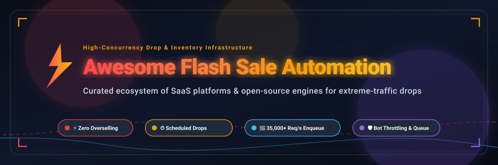

<p align="center">
  
</p>

# ⚡ Awesome Flash Sale Automation 🛍️

<p align="center">
  <a href="https://github.com/ishandutta2007/Awesome-Awesome-Awesome"></a>
  <a href="https://discord.gg/jc4xtF58Ve"></a>
  <a href="https://github.com/ishandutta2007/Awesome-Awesome-Awesome"></a>
  <a href="https://github.com/ishandutta2007/Awesome-Flash-Sale-Automation/stargazers"></a>
  <a href="https://github.com/ishandutta2007/Awesome-Flash-Sale-Automation/network/members"></a>
  <a href="https://github.com/ishandutta2007/Awesome-Flash-Sale-Automation/blob/main/LICENSE"></a>
  <a href="https://github.com/ishandutta2007"></a>
</p>

> 🚀 A curated list of production-grade **Flash Sale Automation** platforms, high-concurrency inventory reservation engines, drop infrastructure, and campaign scheduling tools.

---

## 📖 Overview

**Flash Sale Automation** enables e-commerce merchants, high-traffic retailers, and ticketing platforms to execute time-limited drops and viral flash sales without downtime or inventory disasters. These systems orchestrate the entire promotion lifecycle:
- 🛡️ **Pre-Sale & Gating**: Countdown clocks, virtual waiting rooms, queue throttling, bot mitigation, and scheduled feature flags.
- ⚡ **Drop Concurrency**: Atomic in-memory stock reservation (Redis Lua, Go concurrency, memory barriers) ensuring **zero overselling** and eliminating race conditions.
- 🔄 **Lifecycle Automation**: Automated start/end time triggers, theme swapping, real-time dynamic pricing, and instant post-sale price/inventory restoration.

---

## 📑 Table of Contents

- [📊 Sector Overview & Market Dynamics](#-sector-overview--market-dynamics)
- [☁️ SaaS & Hosted Platforms](#️-saas--hosted-platforms)
- [💻 Open-Source GitHub Projects](#-open-source-github-projects)
  - [🚀 High-Concurrency Inventory & Drops](#-high-concurrency-inventory--drops)
  - [🎛️ Feature Flags & Campaign Schedulers](#️-feature-flags--campaign-schedulers)
  - [🏷️ Promotion Rule Engines](#️-promotion-rule-engines)
  - [🏬 Full-Stack E-Commerce & Mall Implementations](#-full-stack-e-commerce--mall-implementations)
- [🏗️ Architecture Blueprint](#️-architecture-blueprint)
- [🤝 How to Contribute](#-how-to-contribute)
- [💖 Support](#-support)
- [📈 Star History](#-star-history)
- [⚠️ Disclaimer](#️-disclaimer)

---

## 📊 Sector Overview & Market Dynamics

The global **Flash Sale Orchestration and High-Concurrency Promotion Automation** sector is estimated at **$1.95 billion in 2026** (growing at ~16.8% CAGR), nested inside the broader **$22.6 billion E-Commerce Automation market**.

Market dynamics reflect a **moderately fragmented, bifurcated ecosystem** rather than a single winner-take-all monopoly:
- 🏢 **Enterprise All-in-One Giants (Concentrated Top Tier)**: Mega-cap platforms like Shopify Plus (Launchpad), Salesforce Commerce Cloud, and Adobe Commerce capture large enterprise retailers looking for turnkey campaign and theme scheduling.
- 🧩 **Specialized Best-of-Breed Middleware (Fragmented Layer)**: High-concurrency inventory protection, feature flagging (LaunchDarkly, GrowthBook), and real-time behavioral personalization (Dynamic Yield, Bloomreach, Optimizely) remain highly contested across specialized vendors and open-source stacks due to distinct architectural trade-offs between latency, database locking, and campaign flexibility.

---

## ☁️ SaaS & Hosted Platforms

The table below lists leading commercial SaaS and hosted platforms for flash sale execution, ordered by **Company Scale (Market Cap / Valuation / Revenue)** descending.

| Platform | Company Scale (Valuation / Revenue) | Starting Tier Pricing | Free Tier Limits / Trial | Core Flash Sale Capabilities |
| :--- | :--- | :--- | :--- | :--- |
| **[Salesforce Commerce Cloud Einstein](https://www.salesforce.com/products/commerce-cloud/)** | **~$199B Market Cap** (~$37B+ ARR) | **1%–2% of Gross Merchandise Value (GMV)** (Growth tier contract; minimum commitments typically ~$150,000/year) | **No self-serve free trial** (Guided enterprise proof-of-concept / sandbox access via sales evaluation only) | AI-driven promotion targeting, automated flash campaign triggers, predictive conversion timing, and enterprise order management. |
| **[Shopify Launchpad](https://apps.shopify.com/launchpad)** | **~$220B Market Cap** (~$10B+ ARR) | **$2,300/month** (Included with Shopify Plus 3-year plan; $2,500/month on 1-year term) | **No self-serve free trial** (Requires Shopify Plus merchant plan contract; standard Shopify 3-day trial does not grant Launchpad) | Native event scheduler for drops: automated start/end dates, collection publishing, bulk percentage/fixed discounts, theme swaps, and automatic price restoration. |
| **[Adobe Commerce Launch](https://business.adobe.com/products/magento/magento-commerce.html)** | **~$100B Market Cap** (~$26B+ ARR) | **~$22,000/year** (~$1,833/month on-prem license for <$1M GMV; Cloud PaaS begins ~$40,000/year) | **No free trial** (Enterprise sales quote required; community alternative available via self-hosted Magento Open Source) | Content Staging & Price Rules engine for scheduling timed sales, previewing catalog discount states by date, and automated campaign sunsetting. |
| **[LaunchDarkly](https://launchdarkly.com/)** | **~$3.0B Valuation** (~$100M+ ARR) | **$10–$12/service connection/month** (Foundation tier; usage-based model with unlimited seats and client MAU billing) | **Free forever plan**: 1 project, 3 environments, 5 service connections, and 1,000 client MAUs (plus 14-day full-feature trial) | Scheduled flag changes and progressive rollouts for gating flash drop access, feature toggles, and VIP access control under heavy traffic spikes. |
| **[Optimizely Feature Experimentation](https://www.optimizely.com/products/experimentation/)** | **~$1.5B–$2.0B Valuation** (~$400M+ ARR) | **~$35,000–$40,000/year** (Contract-based pricing scaled by Monthly Active Users) | **Free forever tier (Optimizely Rollouts)**: Unlimited feature flags and instant rollouts, limited to 1 active concurrent experiment (no credit card required) | Scheduled flag triggers, rule modification at future timestamps, and dynamic variant testing during high-velocity flash campaigns. |
| **[Bloomreach Engagement](https://www.bloomreach.com/en/products/engagement)** | **~$2.2B Valuation** (~$260M+ ARR) | **~$4,000/month** (Contract starting at ~$19,000–$60,000+/year depending on billable customer profiles and monthly visitors) | **No free trial** (Guided enterprise demo and structured customer implementation only) | Real-time catalog triggers that notify interested buyers when flash sale prices activate or inventory drops, coupled with automated cart-recovery workflows. |
| **[Dynamic Yield](https://www.dynamicyield.com/)** | **$325M Acquisition** (by Mastercard; parent ~$450B Cap) | **~$35,000/year** (Enterprise contract scaled by traffic and personalized session volume) | **No self-serve free trial** (Custom sales demo and tailored proof-of-concept pilot only) | Price Drop campaigns that monitor visitor interaction history and trigger algorithmic flash sale discounts and countdown messaging per user. |
| **[BigCommerce Staging](https://www.bigcommerce.com/)** | **~$40M Market Cap** (~$340M ARR) | **$29/month** (Core plan paid annually; $39/month month-to-month, scaling to Enterprise at ~$1,499/month) | **15-day free trial** with full store configuration, integration testing, and sandbox capabilities (no credit card required) | Dedicated staging environment for testing high-traffic promotion rules, scheduled product launches, and automated price rollbacks. |
| **[Kameleoon](https://www.kameleoon.com/)** | **~$30M Valuation** (Venture-backed Series A) | **$495/month** (PBX Starter plan; up to 50,000 Monthly Tracked Users and 10 experiments/month) | **30-day free trial** (Starter trial tier with up to 5,000 MTUs and 10 AI credits; no credit card required) | Predictive flash sale audience targeting, automated behavioral triggers, and server-side feature experimentation. |
| **[Monetate](https://monetate.com/)** | **~$30M–$50M Valuation** (Centre Lane Partners) | **~$4,000/month** (~$50,000/year annual enterprise agreement based on session volume) | **No free trial** (Strictly annual enterprise contracts; requires tailored sales demo) | Fixed start/stop promotions, dayparting scheduling, and Dynamic Testing to automatically exploit winning promotional variants in tight flash windows. |

---

## 💻 Open-Source GitHub Projects

Curated open-source projects for building custom, self-hosted flash sale infrastructure—sorted by **GitHub Stars_Count** descending.

### 🚀 High-Concurrency Inventory & Drops

| Repository | GitHub_Stars | Language / Stack | Architecture & Description |
| :--- | :--- | :--- | :--- |
| **[qiurunze123/miaosha](https://github.com/qiurunze123/miaosha)** | [](https://github.com/qiurunze123/miaosha/stargazers) | Java, Spring Boot, Redis, RabbitMQ | Comprehensive enterprise flash sale blueprint: multi-layer caching, Redis pre-decrement, asynchronous message queue order generation, and Nginx Lua traffic limiting. |
| **[zaiyunduan123/springboot-seckill](https://github.com/zaiyunduan123/springboot-seckill)** | [](https://github.com/zaiyunduan123/springboot-seckill/stargazers) | Java, Spring Boot, Redis, Guava | High-concurrency flash sale system implementing Guava rate limiting, Redis distributed locking, RabbitMQ queuing, and MD5 salt password encryption. |
| **[codingXiaxw/seckill](https://github.com/codingXiaxw/seckill)** | [](https://github.com/codingXiaxw/seckill/stargazers) | Java, Spring, MyBatis, MySQL | Canonical reference implementation of transactional flash sale execution with stored procedures, cache warmups, and row-level lock optimization. |
| **[hfbin/Seckill](https://github.com/hfbin/Seckill)** | [](https://github.com/hfbin/Seckill/stargazers) | Java, Spring Boot, Redis, RabbitMQ | Production-focused flash sale backend with dynamic salt hashing, captcha bot verification, and Redis stock pre-decrementing. |
| **[qqxx6661/miaosha](https://github.com/qqxx6661/miaosha)** | [](https://github.com/qqxx6661/miaosha/stargazers) | Java, Spring Boot, Redis, Kafka | Step-by-step flash sale architectural tutorial covering distributed session management, Redis cache warming, and Kafka transaction messaging. |
| **[chanjarster/artemis-disruptor-miaosha](https://github.com/chanjarster/artemis-disruptor-miaosha)** | [](https://github.com/chanjarster/artemis-disruptor-miaosha/stargazers) | Java, LMAX Disruptor | Non-Redis in-memory flash sale engine leveraging the ultra-low-latency LMAX Disruptor ring buffer to process extreme surges without external caching. |
| **[ThoughtsBeta/flash-sale](https://github.com/ThoughtsBeta/flash-sale)** | [](https://github.com/ThoughtsBeta/flash-sale/stargazers) | Java, Spring Cloud, Redis | Multi-pattern high-concurrency flash sale engine comparing distributed locks, database optimistic locking, and message queue consumer patterns. |
| **[l72683876-beep/kavach-engine](https://github.com/l72683876-beep/kavach-engine)** | [](https://github.com/l72683876-beep/kavach-engine/stargazers) | Go, Python/JS SDKs | Rigorously benchmarked inventory-reservation engine: 2M requests at 3,077 req/s on a 2-core machine with zero double-sells and crash-recovery via log replay. |
| **[yaumulmajid/zero-oversell-commerce](https://github.com/yaumulmajid/zero-oversell-commerce)** | [](https://github.com/yaumulmajid/zero-oversell-commerce/stargazers) | Java 21, Spring Boot, Kafka, PostgreSQL | Clean architectural microservice demonstrating conditional stock decrement (`UPDATE ... WHERE qty > 0`) with transactional outbox and expiry handling. |
| **[FlashCore](https://pypi.org/project/syeedalireza-flashcore/0.1.0/)** | *(PyPI Package)* | Python, FastAPI, Redis Lua | High-concurrency flash sale drop engine utilizing atomic Redis Lua scripts to eliminate race conditions, paired with PostgreSQL eventual consistency and Docker Compose. |

### 🎛️ Feature Flags & Campaign Schedulers

| Repository | GitHub_Stars | Language / Stack | Architecture & Description |
| :--- | :--- | :--- | :--- |
| **[growthbook/growthbook](https://github.com/growthbook/growthbook)** | [](https://github.com/growthbook/growthbook/stargazers) | TypeScript, Node.js, React | Leading open-source feature flagging and A/B testing platform with scheduled rollouts, experiment tracking, and user segmentation for drops. |
| **[Flagsmith/flagsmith](https://github.com/Flagsmith/flagsmith)** | [](https://github.com/Flagsmith/flagsmith/stargazers) | Python, Django, PostgreSQL | Complete self-hosted feature flag and remote configuration platform with scheduling, multivariate flags, and segments for gating sale availability. |
| **[philiprehberger/laravel-feature-flags](https://github.com/philiprehberger/laravel-feature-flags)** | [](https://github.com/philiprehberger/laravel-feature-flags/stargazers) | PHP, Laravel | Lightweight feature flag package supporting time-scheduled flags (`enabled_from`, `enabled_until`) and percentage rollouts for timed drops. |
| **[jewel998/config](https://github.com/jewel998/config)** | [](https://github.com/jewel998/config/stargazers) | TypeScript, Firebase | Lightweight, serverless feature flag alternative to commercial flag platforms with scheduled flag changes and client/server SDKs. |

### 🏷️ Promotion Rule Engines

| Repository | GitHub_Stars | Language / Stack | Architecture & Description |
| :--- | :--- | :--- | :--- |
| **[weijunlike/rule-engine](https://github.com/weijunlike/rule-engine)** | [](https://github.com/weijunlike/rule-engine/stargazers) | PHP, Composer | Cart promotion rule engine supporting tiered discounts, member pricing, and an independent rule mode tailored specifically for flash sales and single-coupon locks. |
| **[jerry-maheswara-github/promotion_kit](https://github.com/jerry-maheswara-github/promotion_kit)** | [](https://github.com/jerry-maheswara-github/promotion_kit/stargazers) | Rust, Cargo | High-performance Rust library for dynamic promotional rule evaluation, voucher validation, usage quota enforcement, and time-window restrictions. |

### 🏬 Full-Stack E-Commerce & Mall Implementations

| Repository | GitHub_Stars | Language / Stack | Architecture & Description |
| :--- | :--- | :--- | :--- |
| **[yudaocode/yudao-mall-uniapp](https://github.com/yudaocode/yudao-mall-uniapp)** | [](https://github.com/yudaocode/yudao-mall-uniapp/stargazers) | Vue 3, Uniapp, TypeScript | 100% open-source mobile mall frontend with native support for flash sales (秒杀), group buying, countdown timers, coupons, and live shopping. |
| **[newbee-ltd/newbee-mall-plus](https://github.com/newbee-ltd/newbee-mall-plus)** | [](https://github.com/newbee-ltd/newbee-mall-plus/stargazers) | Java, Spring Boot, Vue | End-to-end e-commerce system featuring integrated flash sale modules, coupon distribution, payment integration, and inventory locking. |

---

## 🏗️ Architecture Blueprint

Building a resilient, zero-oversell flash sale system requires a multi-tier defense architecture:

```
[ Incoming Surge Traffic ]
          │
          ▼
┌─────────────────────────────────┐
│ 1. Edge & Virtual Waiting Room  │  --> Rate limiting, CAPTCHA, Cloudflare/Nginx Lua queues
└────────────────┬────────────────┘
                 │
                 ▼
┌─────────────────────────────────┐
│ 2. Campaign & Feature Gating   │  --> Scheduled flags (LaunchDarkly, GrowthBook, Flagsmith)
└────────────────┬────────────────┘
                 │
                 ▼
┌─────────────────────────────────┐
│ 3. Atomic In-Memory Reservation │  --> Redis Lua / Kavach Engine / Go channels (Zero Overselling)
└────────────────┬────────────────┘
                 │ (Async Event)
                 ▼
┌─────────────────────────────────┐
│ 4. Message Broker & Persistence │  --> Kafka / RabbitMQ -> Transactional DB (PostgreSQL / MySQL)
└─────────────────────────────────┘
```

1. 🌐 **Edge Protection**: Absorb 90% of repeated polling traffic via CDN caching and virtual waiting rooms.
2. ⏱️ **Scheduled Activation**: Open product pages down to the exact second via synchronized feature flag schedules.
3. 🔒 **Atomic Decrement**: Never issue `SELECT ... FOR UPDATE` directly to relational databases during peak spikes. Use atomic Redis Lua scripts or memory-mapped log engines like **Kavach Engine**.
4. 📨 **Asynchronous Fulfillment**: Push confirmed reservations to Kafka/RabbitMQ for decoupled payment processing, cart timeout expiration workers, and final DB persistence.

---

## 🤝 How to Contribute

1. 🍴 Fork this repository.
2. 📝 Add your tool or library following the table formatting conventions:
   - Provide exact pricing and free tier/trial limits for SaaS products.
   - Include official GitHub stargazer badges (`style=social&color=white`) linking to the stargazers page for open-source repositories.
3. 🎯 Keep descriptions concise, factual, and architecturally focused.
4. 🚀 Submit a Pull Request.

---

## 💖 Support

Thank you for exploring this curated guide to flash sale automation! If this repository has helped you scale your flash sale architectures, safeguard inventory, or prevent overselling incidents:

- ⭐ **Star this repository** to show your appreciation and help others discover it.
- 🍴 **Fork and contribute** new tools, benchmarks, and architectures.
- 📢 **Share it** with fellow e-commerce architects and backend developers on Twitter, LinkedIn, and Discord.
- ☕ **Buy me a coffee**: If you'd like to support the ongoing maintenance and curation of open-source research lists, visit the [Sponsor Dashboard](https://github.com/sponsors/ishandutta2007).

---

## 📈 Star History

[](https://star-history.dera.page/#ishandutta2007/Awesome-Flash-Sale-Automation&type=date&legend=top-left)

---

## ⚠️ Disclaimer

- This list is community-curated for informational purposes and does not constitute commercial endorsement.
- Flash sale systems handling payment transactions and customer identities must adhere to PCI DSS and local data compliance regulations.
- Inventory guarantees must be validated under load testing (e.g., k6, Locust, or JMeter) before production deployment.

---

<p align="center">
  <b>⚡ Maintained with care by the open-source community for e-commerce architects, high-concurrency engineers, and DevOps teams.</b>
</p>
